# 상품 관리 REST API

## 1. 프로젝트 소개

### 주제 및 주요 기능

Spring Boot와 JPA를 활용한 상품 관리 REST API이다.
상품 등록·조회·수정·삭제를 구현했다.

### Entity 필드 구조

Product 엔티티는 products ㅌ테이블에 매핑된다.

| 필드 | 타입 | 설명 |
| --- | --- | --- |
| id | Long | 자동 생성되는 기본 키 |
| name | String | 상품명, 필수, 최대 100자 |
| price | Integer | 가격, 필수, 0 이상 |
| category | String | 카테고리, 최대 50자 |
| stock | Integer | 재고, 필수, 0 이상 |
| description | String | 설명, 최대 1,000자 |

### 프로젝트 구조 및 개발환경

- 개발환경: Java 17, Spring Boot 4.1.2, Spring Data JPA, MariaDB, Gradle
- 구조: Controller → Service → Repository → DB
- API 경로: /api/products (POST·GET), /api/products/{id} (GET·PUT·DELETE)

### 저장소 및 배포 주소

- GitHub Repository URL: https://github.com/2026-2-WebService/assign09-c01-22500802
- 개인 저장소: https://github.com/yechan-7942/2026WEB_assign_09
- Render Deployment URL:
- 배포 주소: https://two026web-assign-09-1.onrender.com
- 상품 전체 조회: https://two026web-assign-09-1.onrender.com/api/products

## 2. Database SQL Practice

### 1. 기존 Table 조회 및 데이터 추가 결과

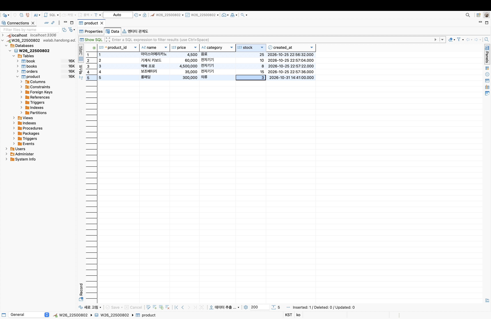

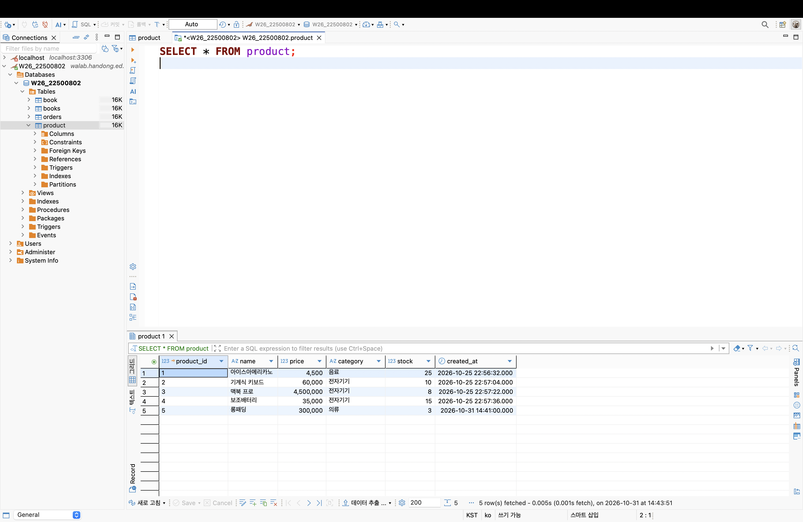

### 2. 새 테이블 생성 SQL

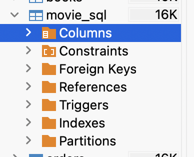
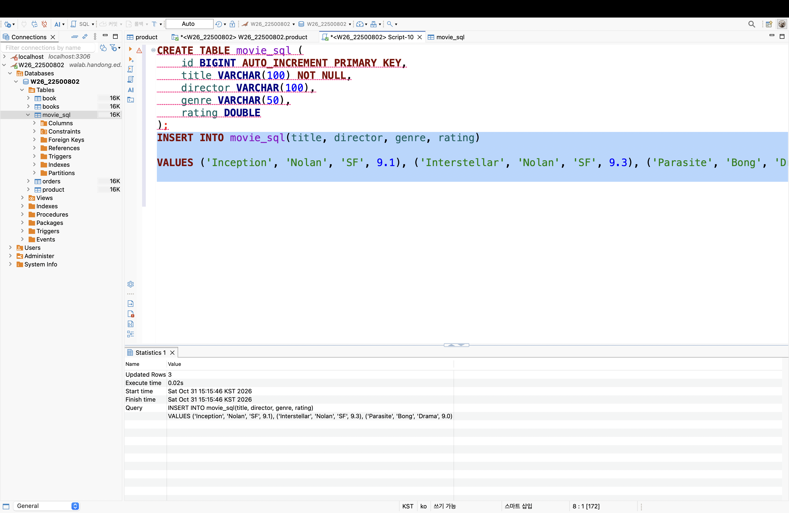

### 3. INSERT / UPDATE / DELETE / SELECT SQL과 실행 결과
INSERT

UPDATE

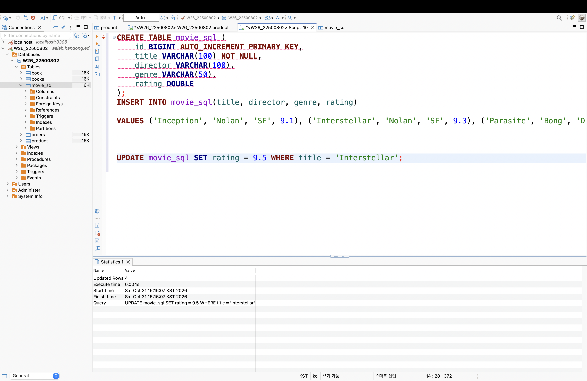

DELETE

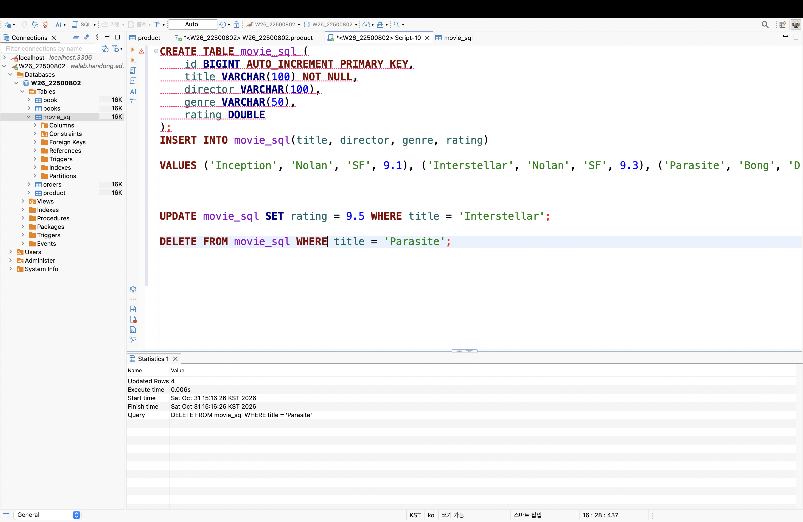

SELECT

SELECT: title, rating

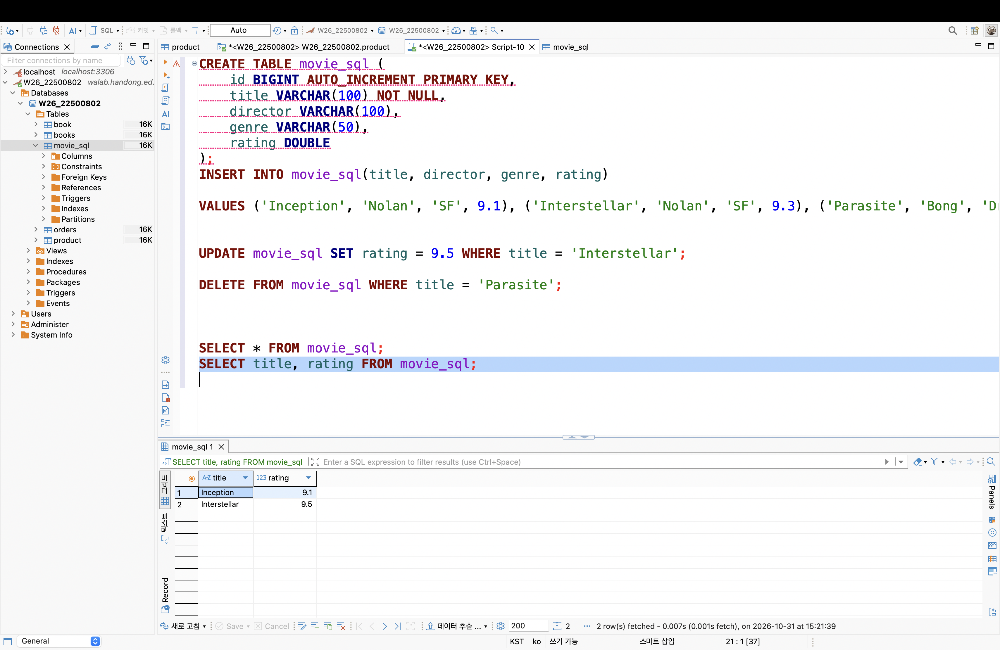

SELECT: SF

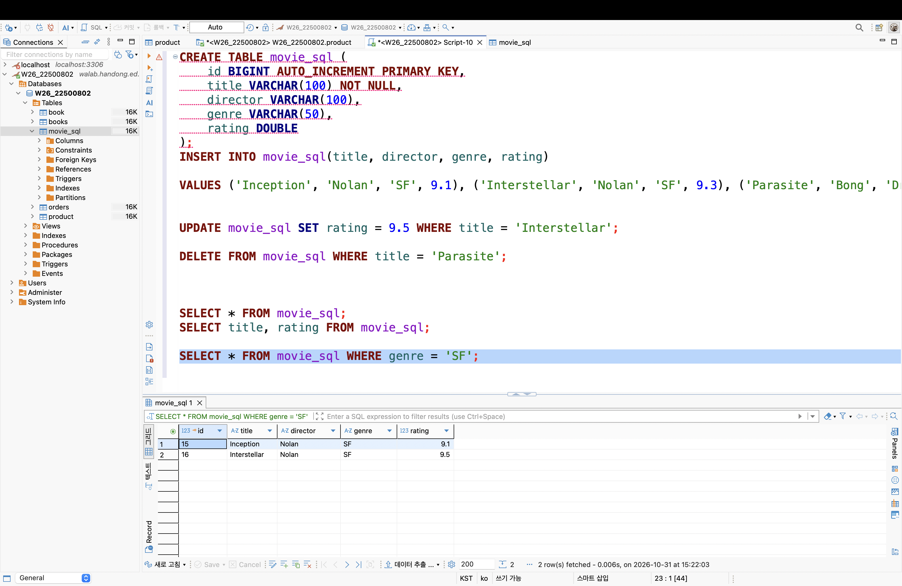

## 3. Spring Data JPA 구현

### Entity와 Repository

상품을 관리하는 Product를 만들었다. 필드는 id, name, price, category, stock, description이다.
JPA 테이블은 products이고, SQL 실습 테이블인 movie_sql과 구분했다.

ProductRepository는 JpaRepository&lt;Product, Long&gt;을 상속해서 기본 CRUD 기능을 사용한다.

| Annotation | 역할 |
| --- | --- |
| @Entity | JPA가 관리하는 클래스 |
| @Table | 테이블 이름 지정 |
| @Id | 기본 키 지정 |
| @GeneratedValue | id 자동 생성 |
| @Column | 필수 여부와 길이 지정 |

Entity의 필드는 DB의 컬럼과 연결된다. Java의 Long은 BIGINT, Integer는 INT, String은 지정한 길이의 VARCHAR로 매핑된다.

### REST API

| 메서드 | 주소 | 기능 |
| --- | --- | --- |
| POST | /api/products | 등록 |
| GET | /api/products | 전체 조회 |
| GET | /api/products/{id} | 단건 조회 |
| PUT | /api/products/{id} | 수정 |
| DELETE | /api/products/{id} | 삭제 |

롱패딩 등록 요청:

{"name":"롱패딩","price":300000,"category":"의류","stock":3,"description":"겨울용 롱패딩"}

등록 응답(201):

{"id":2,"name":"롱패딩","price":300000,"category":"의류","stock":3,"description":"겨울용 롱패딩"}

전체 조회는 상품 목록을 배열로 반환한다. 단건 조회와 수정은 상품 하나를 반환하고, 삭제 성공 시 응답 본문은 없다. 없는 id는 404로 처리한다.

## 4. JPA와 SQL 비교

| 메서드 | 사용 결과 | 관련 SQL |
| --- | --- | --- |
| save() | 등록 또는 수정 | INSERT / UPDATE |
| findAll() | 전체 조회 | SELECT |
| findById() | id로 조회 | SELECT + WHERE |
| deleteById() | id로 삭제 | DELETE |

DBeaver에서는 SQL을 직접 입력했다. JPA에서는 Repository 메서드를 호출하면 Hibernate가 SQL을 만들어 실행한다.
수정·삭제 전 상품을 확인하므로 SELECT가 함께 실행될 수도 있다.

spring.jpa.show-sql=true로 SQL이 출력되도록 설정했다.

실행 콘솔에서 다음 INSERT와 SELECT 로그를 확인했다.

Hibernate: insert into products (category,description,name,price,stock) values (?,?,?,?,?)

Hibernate: select p1_0.id,p1_0.category,p1_0.description,p1_0.name,p1_0.price,p1_0.stock from products p1_0

INSERT는 상품 등록, SELECT는 전체 조회 때 실행된다. 물음표는 실행할 때 값이 바인딩되는 자리이다.
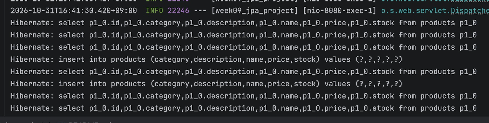

## 5. 배포 및 환경 설정

환경변수는 DB_URL, DB_USERNAME, DB_PASSWORD를 사용했다.
IntelliJ의 실행 설정과 Render의 Environment에 등록했다. 
GitHub 저장소를 연결하고 Dockerfile을 추가해서 Render에 배포했다.
처음에는 Node로 설정되어 yarn start 오류가 났다. Runtime을 Docker로 변경한 뒤 빌드와 DB 연결이 성공했다.

배포 후 AI가 임시 상품으로 CRUD를 검사했다.

| 테스트 | 결과 |
| --- | --- |
| 등록 | 201 |
| 전체·단건 조회, 수정·수정 결과 조회 | 200 |
| 삭제 | 204 |
| 삭제한 id 조회·수정·삭제 | 404 |
| 음수 가격 등록 | 400 |

테스트 상품은 삭제했고 기존 상품 6개는 유지되었다. DBeaver의 products 데이터와 배포 API에서 같은 상품 6개를 확인했다.
기본 주소에는 화면이 없어서 404가 나오고, 상품 조회는 /api/products로 접속한다.

### 직접 실행한 배포 CRUD 테스트

POST로 러닝화를 등록해 201 응답과 id 9를 받았다. DBeaver에서도 같은 상품이 저장된 것을 확인했다.

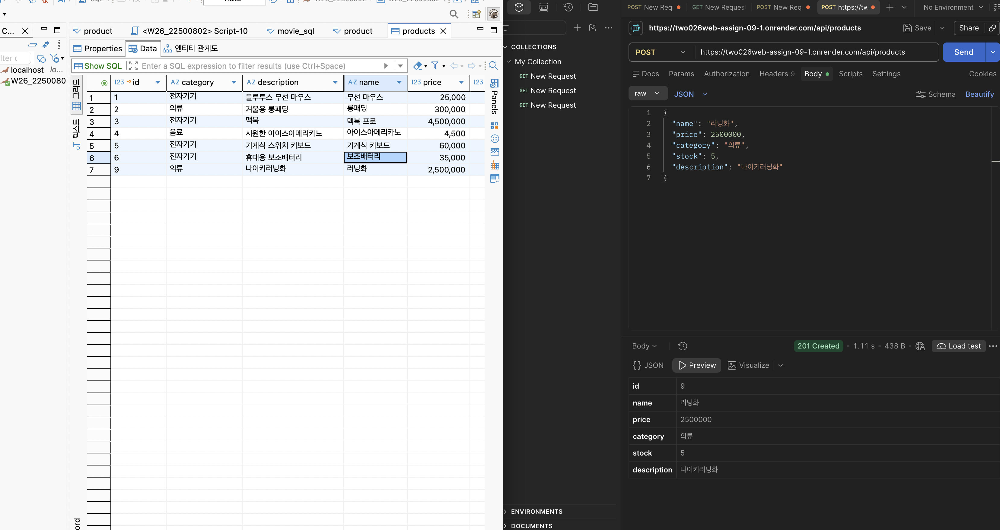

GET /api/products/9로 등록한 러닝화를 조회해 200 응답을 확인했다.

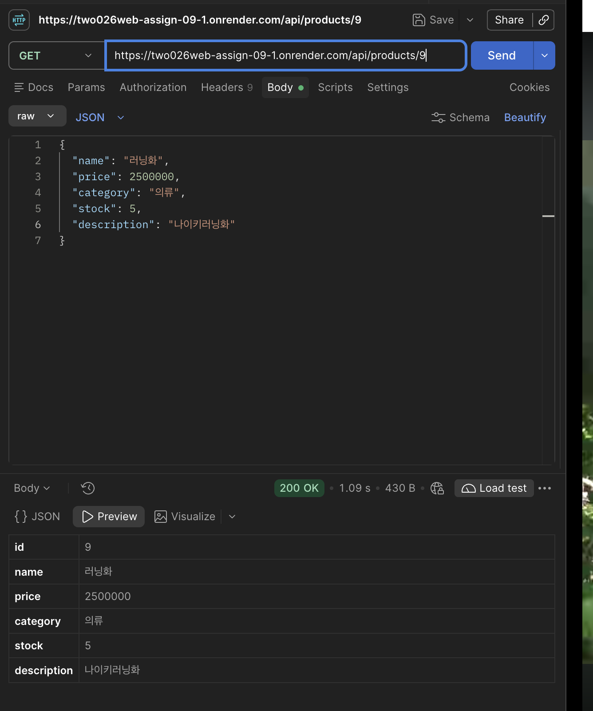

PUT /api/products/9로 가격을 2,500,000원에서 3,000,000원으로 수정했다. 200 응답과 DBeaver의 가격 변경을 확인했다.

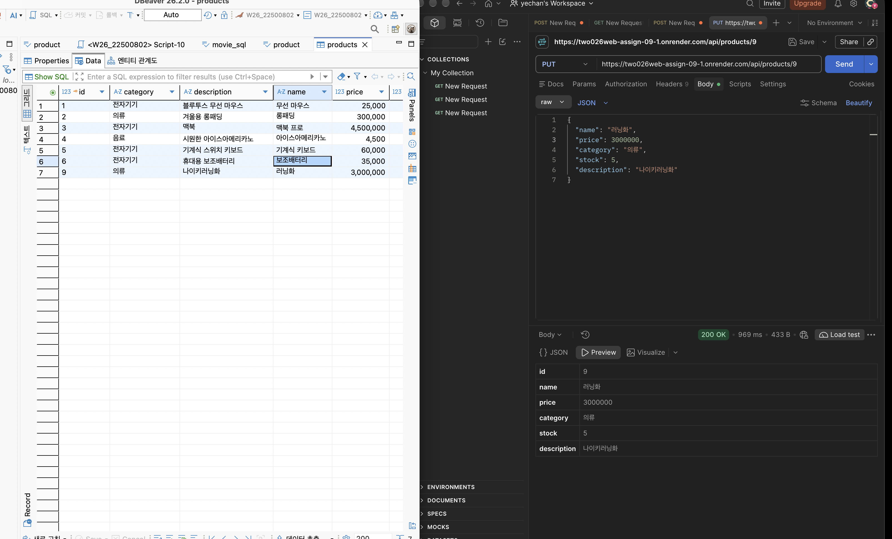

삭제 테스트는 id 1 상품으로 진행해 204 응답을 확인했다. 삭제 성공 시 응답 본문은 비어 있다.

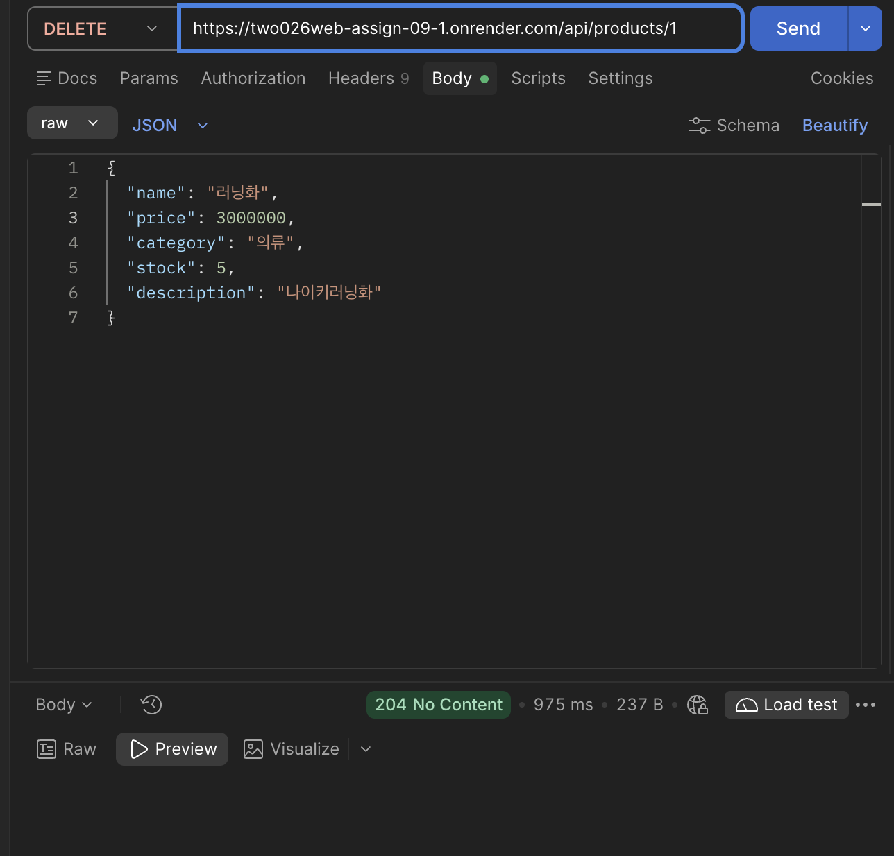

DBeaver를 새로고침해 id 1이 조회 목록에서 사라진 것을 확인했다.

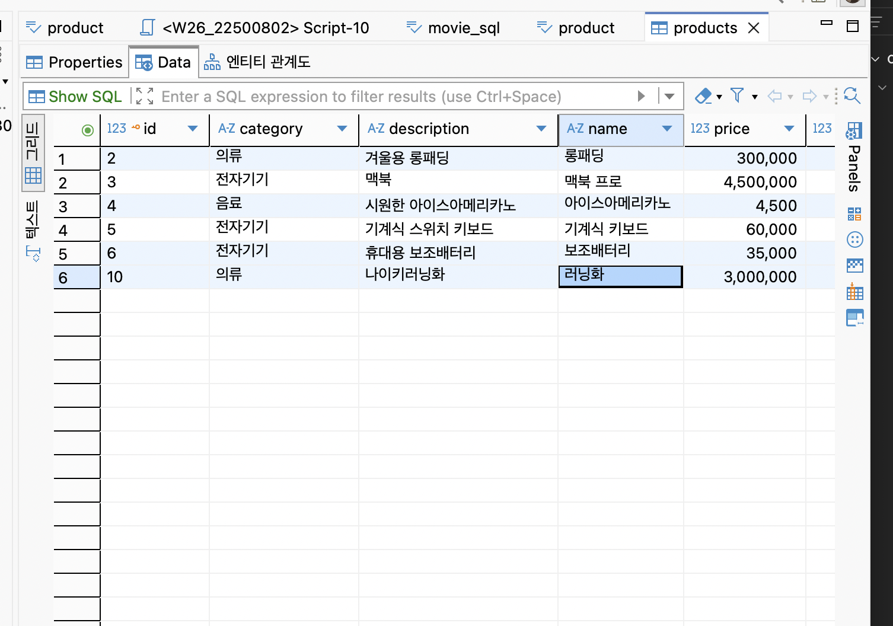

## 6. Weekly Report

### Key Learning

1. Entity의 필드와 DB 컬럼이 어떻게 연결되는지 살펴봤다.
2. JpaRepository를 상속하면 기본 CRUD 메서드를 사용할 수 있다.
3. 로컬과 Render의 환경변수는 각각 설정해야 한다.

### Problem & Solution

Render 배포가 계속 실패했다. 로그를 보니 Node로 실행되고 있었다.
AI의 도움으로 Docker 설정으로 바꿨고, 배포와 DB 연결이 성공했다.

### Code Review

return productRepository.findById(id)
.orElseThrow(() -> new ResponseStatusException(
HttpStatus.NOT_FOUND, "상품을 찾을 수 없습니다: " + id));

id로 상품을 찾고, 없으면 404 오류를 발생시킨다. 조회·수정·삭제에서 같은 코드를 사용한다.

### AI Usage

AI가 Entity, DTO, Repository, Service, Controller와 Dockerfile을 작성했다. 배포 오류 해결, 자동 CRUD 검사와 README 초안에도 AI를 사용했다.
직접 진행한 부분: DBeaver SQL 실습, IntelliJ 환경변수 입력, 로컬 curl 등록 테스트

- 직접 수정·재검증한 부분: 80%
- 본인이 판단한 AI 사용률: 20%

### Reflection

Entity와 DTO를 나누는 이유와 트랜잭션을 더 공부하고 싶다
. 작성된 코드 중에서 거의 sample에시를 보면서 했는데 스스로 안보고 작성해봐야겠다. 
